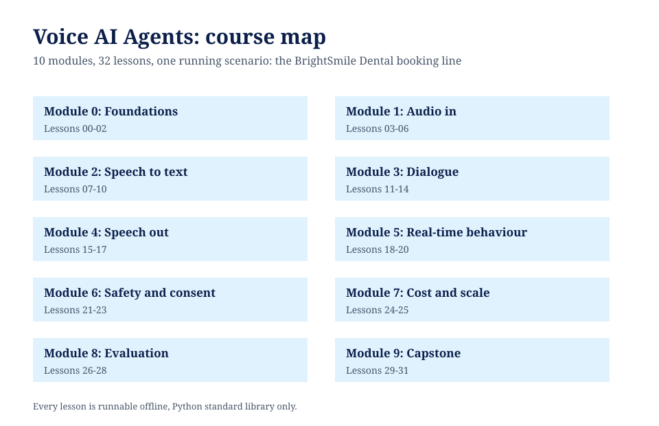
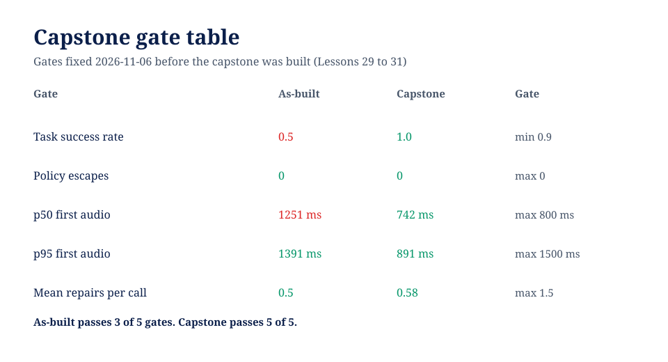
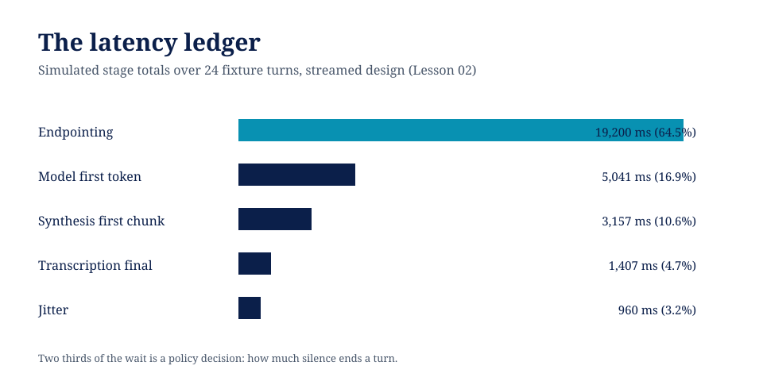

# Voice AI Agents

A free, builder-level course on voice agents: the speech pipeline, the latency budget, and the discipline of measuring both. Thirty-two lessons, ten modules, one running scenario: the appointment line of a fictional dental clinic, built, broken, and hardened in the open.



No API keys, no audio hardware, no live services. Everything runs offline on the Python standard library. Speech components (capture, VAD, recognition, synthesis) are deterministic local stand-ins with their rules written in the code, driven by bundled fixtures: 24 reference utterances and 12 scripted calls. Every number in every lesson is produced by that lesson's own code on those fixtures, and latency figures are simulated budgets, labelled as such. Real-world platform figures live in [RESEARCH.md](RESEARCH.md), with sources and check dates, kept separate from the course's own measurements on purpose.

## What you will be able to do

- Take a spoken turn apart stage by stage and say where its milliseconds went, with a ledger to prove it.
- Explain why endpointing, not the model, dominates voice latency, and design an endpointing policy that does not cut off slow speakers.
- Build a slot-filling voice dialogue that books real appointments against a schedule, and grade it independently of itself.
- Defend the two payloads that matter (phone numbers and names) with read-back correction and spelling, and quote the measured difference.
- Price a voice agent honestly: latency budgets at p50 and p95, cost per successful call with waste counted, and capacity under bursty demand.
- Put consent, disclosure, and sensitive-data handling into the pipeline as gates, and count policy escapes separately from task failures.
- Evaluate changes the way the course evaluates its own: frozen fixtures, per-family scores, hurt counts reported. One of the course's own proposed fixes fails its evaluation and stays rejected in print (Lesson 26).

## The scorecard

Measured by the course's code on the bundled fixtures, as-built system against hardened capstone:



| Measure | As-built | Hardened |
|---|---|---|
| Task success (12 calls) | 6 of 12 (0.5) | 12 of 12 (1.0) |
| Policy escapes | 0 | 0 |
| p50 first audio (simulated) | 1,251 ms | 742 ms |
| p95 first audio (simulated) | 1,391 ms | 891 ms |
| Mean repairs per call | 0.5 | 0.58 |
| Cost per successful booking (teaching rates) | $0.0548 | $0.0581 |
| Total spend on the call set | $0.761 | $0.6453 |
| Spend wasted on failed calls | $0.4774 | $0.00 |

The hardened system costs more per successful booking because its successes now include the hard calls. Its total spend is lower because it stops burning minutes on failures. Both facts are in the table; a course that showed only the flattering one would not be worth your time.

More headline measurements: endpointing is 64.5 percent of the simulated latency ledger across 24 turns (Lesson 02). Fixed 400 ms and 800 ms endpointing each cut off all three slow fixture utterances; the adaptive policy cuts off one (Lesson 06). Committing to a streaming transcript at 60 percent of the words scores 0.4135 WER against the final's 0.0702 (Lesson 10). Phone numbers arrive exactly right 5 of 12 times unconfirmed, 12 of 12 after digit-level read-back correction (Lesson 09). One concurrent agent loses 129 of 490 calls on a clustered teaching day; four lose none (Lesson 25).



## Course map

| Module | Lessons | What it covers |
|---|---|---|
| 0 Foundations | 00-02 | Setup, what makes voice different, the latency ledger |
| 1 Audio in | 03-06 | Capture, the telephone channel, VAD, endpointing |
| 2 Speech to text | 07-10 | The STT stand-in, noise as data, numbers and names, streaming partials |
| 3 Dialogue | 11-14 | The dialogue manager, confirmation and repair, tool calls, spoken output |
| 4 Speech out | 15-17 | The TTS stand-in, streaming synthesis, barge-in |
| 5 Real-time behaviour | 18-20 | The latency budget, turn-taking, voice failure modes |
| 6 Safety and consent | 21-23 | Consent and disclosure, sensitive data, escalation and handoff |
| 7 Cost and scale | 24-25 | Cost per minute, concurrency and capacity |
| 8 Evaluation | 26-28 | Evaluating transcripts, evaluating conversations, failure taxonomy |
| 9 Capstone | 29-31 | Spec with gates fixed in advance, the build, the grading |

## How to run it

```bash
git clone https://github.com/techaurah/voice-ai-agents-course
cd voice-ai-agents-course
cd 00-course-setup && python3 check_environment.py
```

Then work through the lessons in order. Each lesson folder is self-contained: a README, one runnable artifact, an exercise, a smoke test that verifies the lesson's headline numbers, and a worked solution. Run the validators any time:

```bash
python3 tools/validate_course.py
python3 tools/check_links.py
```

## Repository layout

- Numbered folders `00` to `31`: the lessons.
- `vox/`: the shared stand-in library (audio, VAD, STT, TTS, latency, metrics, dialogue), each module stating its own rules.
- `fixtures/`: the utterances, calls, schedule, policy, and rates every lesson measures against.
- `tools/`: the structural validator and link checker.
- `assets/visuals/`: branded diagrams with their generator.
- `RESEARCH.md`: the competitor and platform research the course was designed against. `DESIGN.md`: the design decisions.

## Honest negatives

This course keeps its failures in print. The as-built system passes only 3 of the capstone's 5 gates. The adaptive endpointing policy still cuts off one slow utterance in three. A plausible vocabulary fix is rejected by its own evaluation in Lesson 26. A mid-course system passes 4 of 5 gates while still failing half its calls, and Lesson 31 uses it to show where the next unit of work belongs. If a technique measures worse here, the lesson says so, because that is the result the fixtures produced.

## About TechAurah

TechAurah is the academy name of TechAura, an AI and software engineering company that builds intelligent systems for businesses and publishes what it learns as free, runnable courses. More courses and projects: [github.com/techaurah](https://github.com/techaurah). Company background: [TechAura on LinkedIn](https://www.linkedin.com/company/techaurah/).

## License

MIT. See [LICENSE](LICENSE).
